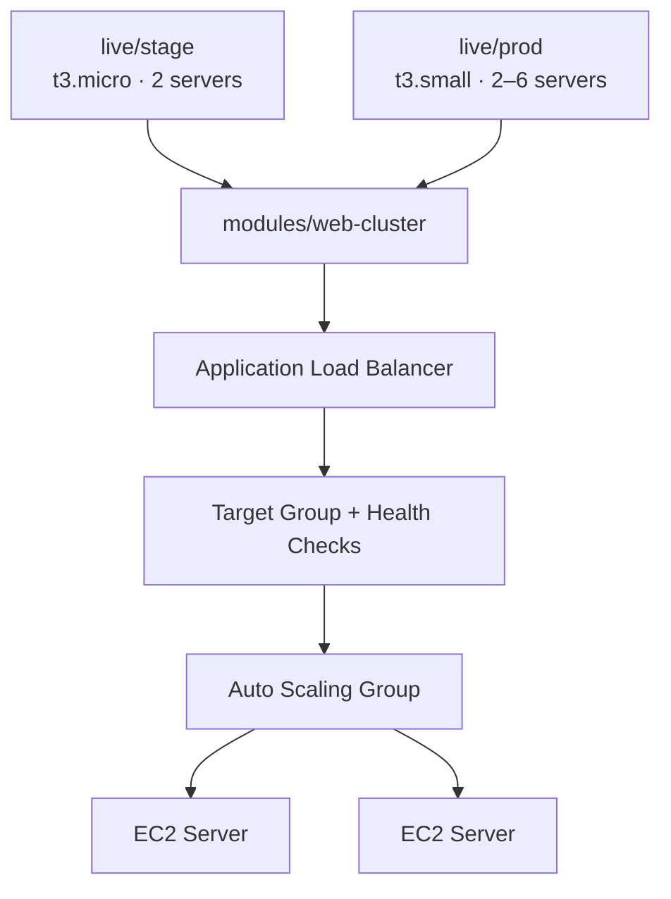

# Modular Infrastructure with Terraform

A reusable web cluster module, deployed to separate staging and production environments with different settings. Both environments share one copy of the infrastructure logic.

## Architecture



## Structure

```
tf-modular-infra/
+-- modules/
¦   +-- web-cluster/     # Reusable module: ALB, ASG, launch template, security groups
¦       +-- main.tf
¦       +-- variables.tf
¦       +-- outputs.tf
+-- live/
    +-- stage/           # Calls the module with small settings
    +-- prod/            # Calls the same module with production settings
```

## Module Inputs

| Variable | Description | Default |
|---|---|---|
| `cluster_name` | Name prefix for all resources | required |
| `instance_type` | EC2 instance type | required |
| `min_size` | Minimum number of servers | required |
| `max_size` | Maximum number of servers | required |
| `server_port` | Port the servers listen on | `8080` |

## Usage

```bash
cd live/stage
terraform init
terraform apply
```

Each environment stores its state separately in S3, with native locking.

## What I learned

- (write your own observations here)
